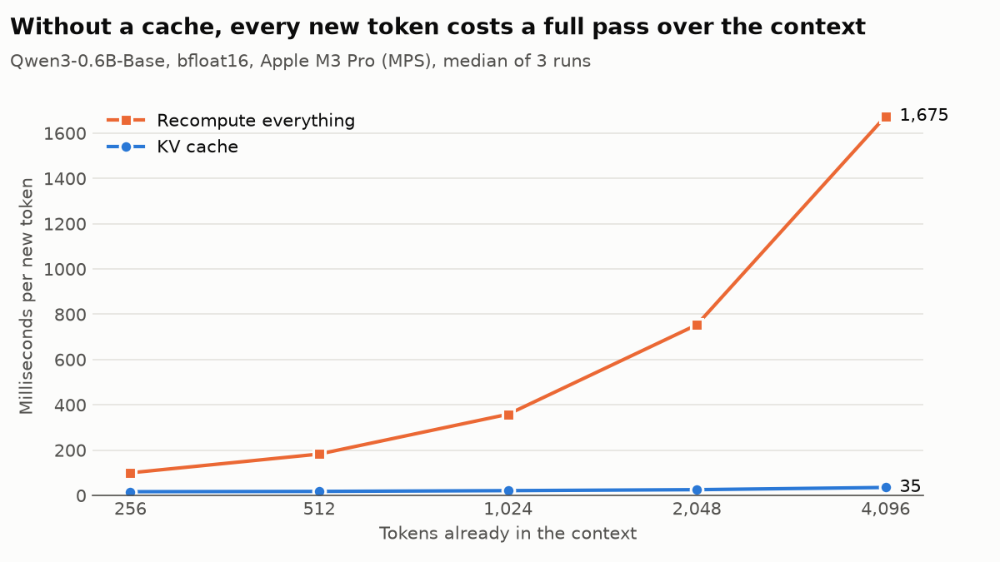
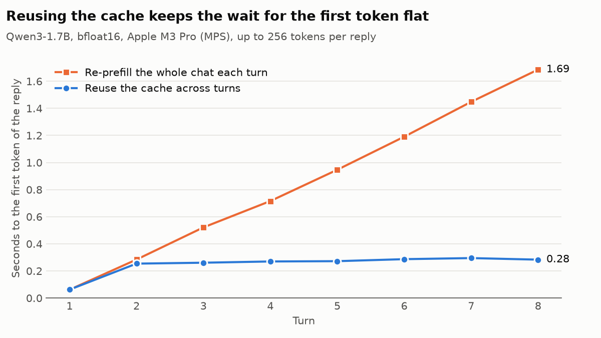

# LLM Inference Engine: Qwen3 in pure PyTorch

[](https://github.com/Viktor-Bubanja/LLM-Inference-Engine/actions/workflows/ci.yml)

I started this project by following Sebastian Raschka's excellent
[*Build a Large Language Model (From Scratch)*](https://github.com/rasbt/LLMs-from-scratch),
and enjoyed it enough to keep going past the last chapter. This repo is where
I went next: [Qwen3](https://huggingface.co/Qwen) (0.6B and 1.7B) built from
scratch, with RoPE, grouped-query attention and QK-norm, running the official
weights. There's no `transformers` code at runtime, just PyTorch,
`safetensors` and `tokenizers`.

- **Verified against Hugging Face:** in fp32 the logits are bit-identical to
  `transformers`, and greedy decoding produces the same tokens.
- **A KV cache built for chat:** keys are cached after RoPE, the causal mask
  accounts for the cached tokens, and a multi-turn chat reuses the cache
  across turns instead of re-reading the whole conversation.
- **Benchmarked:** how much time the cache saves as the context grows, how
  much memory grouped-query attention saves, and how the speed compares with
  `transformers` on the same machine.

## Results

<picture>
  <source media="(prefers-color-scheme: dark)" srcset="docs/img/decode-dark.png">
  
</picture>

Milliseconds per new token:

| context | KV cache | recompute | speed-up |
|---:|---:|---:|---:|
| 256 | 16.5 | 99.8 | 6.0× |
| 512 | 17.8 | 182.7 | 10.3× |
| 1,024 | 21.1 | 358.3 | 16.9× |
| 2,048 | 25.4 | 753.4 | 29.6× |
| 4,096 | 35.2 | 1,674.6 | 47.6× |

Without a cache, each new token means running the whole context through the
model again, so the cost per token grows with the context (100 ms to
1.7 s). With the cache, only the new token goes through the model and
attends to the stored keys and values: the cost still grows with the keys it
reads, but slowly (16 to 35 ms), so at 4,096 tokens the cache is 48× faster.

<picture>
  <source media="(prefers-color-scheme: dark)" srcset="docs/img/chat-dark.png">
  
</picture>

Seconds, per turn:

| turn | prompt tokens | first token, cache reused | first token, re-prefilled | whole reply, reused | whole reply, re-prefilled |
|---:|---:|---:|---:|---:|---:|
| 1 | 27 | 0.06 | 0.06 | 9.5 | 8.8 |
| 2 | 307 | 0.25 | 0.28 | 10.2 | 9.4 |
| 3 | 583 | 0.26 | 0.52 | 10.7 | 9.7 |
| 4 | 853 | 0.27 | 0.72 | 11.0 | 10.4 |
| 5 | 1,127 | 0.27 | 0.95 | 11.8 | 11.2 |
| 6 | 1,402 | 0.29 | 1.19 | 12.4 | 11.6 |
| 7 | 1,679 | 0.29 | 1.45 | 13.1 | 12.4 |
| 8 | 1,953 | 0.28 | 1.69 | 13.2 | 13.5 |

A chat is a growing prompt. `ChatSession` keeps the cache between turns,
finds the longest prefix of the newly rendered conversation that is already
cached, and prefills only the rest, so the wait before a reply starts stays
flat (6× shorter by turn 8). The time for the whole reply barely changes:
decoding 256 tokens dominates it, and the two differ by under a second
either way, about as much as at turn 1, where both do identical work.

**Grouped-query attention halves the cache.** Qwen3 shares each key/value
head between two query heads. Measured from the cache's buffers:

| model | KV heads (GQA) | per token | at 32k tokens | with one KV head per query head |
|---|---:|---:|---:|---:|
| Qwen3-0.6B-Base | 8 of 16 | 112 KiB | 3.5 GiB | 224 KiB, 7.0 GiB |
| Qwen3-1.7B | 8 of 16 | 112 KiB | 3.5 GiB | 224 KiB, 7.0 GiB |

**Against `transformers`**, in tokens per second, with the same weights,
dtype, device and prompt (512 tokens, then 128 new), greedy decoding and a
KV cache on both sides:

| model | prefill (ours) | prefill (HF) | decode (ours) | decode (HF) |
|---|---:|---:|---:|---:|
| Qwen3-0.6B-Base | 2,796 | 3,582 | 55.2 | 74.6 |
| Qwen3-1.7B | 1,266 | 1,519 | 27.7 | 32.5 |

`transformers` is 17–35% faster at decoding and 20–28% faster at prefill.
The gap hasn't been profiled yet. Likely candidates: per-token work in
`generate` (a stop check that waits for the GPU every step, and a token
context that grows for the hooks), and copying key/value heads with
`repeat_interleave` instead of letting attention broadcast them.

**Parity** with `transformers` in fp32 on CPU, from
`benchmarks/run.py parity` (the network tests check the same with a
tolerance):

| model | max \|Δ logit\| | greedy tokens identical |
|---|---:|---|
| Qwen3-0.6B-Base | 0 (bit-identical) | 64 of 64 |
| Qwen3-1.7B | 0 (bit-identical) | 64 of 64 |

Timings: Apple M3 Pro (36 GB), PyTorch 2.14.1, bf16 on MPS. Raw results are in
[`benchmarks/results`](benchmarks/results).

## How it works

| Piece | Code |
|---|---|
| **RoPE.** Rotates each query/key pair by an angle proportional to the token's position, so attention scores depend only on relative position. Uses Qwen's "rotate-half" pairing (dimension `i` with `i + d/2`), and computes the angles in fp32 even when the model runs in bf16, which can't represent large angles precisely. | [`rope.py`](src/llm_from_scratch/rope.py) |
| **Grouped-query attention with QK-norm.** 16 query heads share 8 key/value heads; queries and keys are RMS-normalised per head before RoPE. | [`attention.py`](src/llm_from_scratch/attention.py) |
| **KV cache.** Preallocated per-layer buffers that hold KV heads, not query heads. Keys are stored after RoPE: a token's position never changes, so neither does its rotated key. New queries attend to every cached key, and causally to each other ([`cached_causal_mask`](src/llm_from_scratch/attention.py#L9)). | [`kv_cache.py`](src/llm_from_scratch/kv_cache.py) |
| **Reuse across chat turns.** Re-renders the conversation with the chat template, truncates the cache to the longest common prefix and prefills the rest. Qwen3's template drops the empty think block from earlier replies, so the previous reply is prefilled again too. | [`generation.py`](src/llm_from_scratch/generation.py#L109) |
| **Residual hooks.** Functions called on the residual stream after each block, given each token's position, turn and role. PyTorch forward hooks can't tell which tokens they see under cached decoding; these can, so position-dependent edits such as activation steering stay correct with the cache. | [`causal_lm.py`](src/llm_from_scratch/causal_lm.py#L66) |
| **Weight loading.** Reads the checkpoint's `config.json` and `safetensors` shards from the Hub, pinned to a commit, and maps the parameter names. | [`hf_loading.py`](src/llm_from_scratch/hf_loading.py) |

## Quickstart

Needs [uv](https://docs.astral.sh/uv/) and Python 3.11+. Runs on CUDA, Apple
silicon (MPS) or CPU.

```bash
uv sync
uv run python -m llm_from_scratch.chat     # chat with Qwen3-1.7B (downloads ~4 GB)
uv run pytest                              # fast tests: CPU, no network
uv run pytest -m network                   # parity with transformers on the real weights
uv run python benchmarks/run.py decode     # or chat, kv-memory, hf, parity
uv run python benchmarks/plot.py           # plots and tables from the results
```

## Credits

Started from Sebastian Raschka's
[*Build a Large Language Model (From Scratch)*](https://github.com/rasbt/LLMs-from-scratch)
(Apache 2.0), which builds GPT-2. Qwen3 weights by the
[Qwen team](https://huggingface.co/Qwen) (Apache 2.0).

## License

[Apache 2.0](LICENSE)
